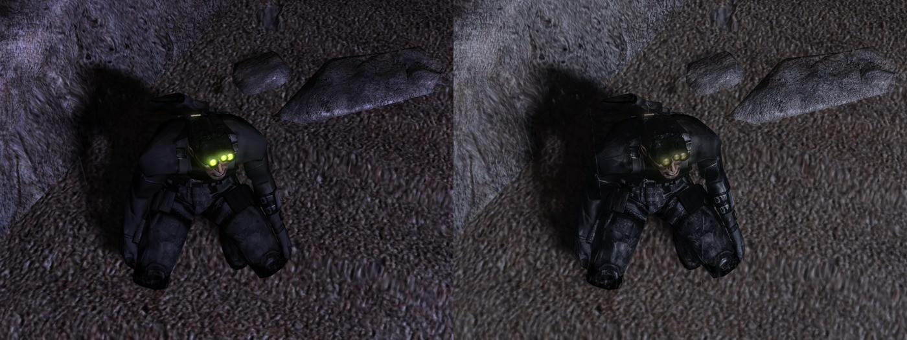
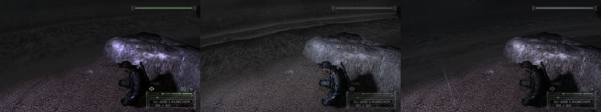

# Tuning for realism

Everything in the main guide gets the pipeline running. These are the settings that made the
result look clearly better, in the order they mattered. Measured on an RTX 5090 at 3840x2160.



*Left: the game with Shader Model 3.0, neural pass off. Right: same frame position with the tuned
neural pass. Crop of a 3840x2160 capture.*

## 1. Fix the depth orientation (biggest single fix)

ReShade's default assumes a reversed depth buffer. This game's depth (through dgVoodoo2) is a
normal one, so the neural model was being guided by inverted depth. In `System/ReShade.ini`:

```
[GENERAL]
PreprocessorDefinitions=RESHADE_DEPTH_INPUT_IS_REVERSED=0
```

Check: enable the `DLSS5_Feed_Debug` technique with `DEBUG_VIEW=1` in `ReShadePreset.ini`. Wrong
orientation gives a pure white screen; correct gives bright near geometry and a dark sky.
Afterwards `dlss5-feed.log` says `depth reversed=0` and `OptiScaler.log` says
`guides: depth not inverted`.

## 2. Run the Feeder at full working resolution

`work_resolution=67` + `work_upscale=2` is described by the Feeder's own README as an experiment
that shimmers and saves nothing. In `System/dlss5-feed.cfg`:

```
work_resolution=100
work_upscale=0
work_sharpness=0.00
```

## 3. Use the game's best renderer

Out of the box the game ran Shader Model 1.1, no anisotropic filtering, medium shadows and
high-quality textures off. In the live `SplinterCell3.ini` (the ProgramData copy in the prefix),
section `[WinDrv.WindowsClient]` / `[D3DDrv.D3DRenderDevice]`:

```
ShaderModel=3
Anisotropy=16
ShadowQuality=2
HiResTextures=1
UseHWShadowMapping=True
```

(`HDR=1`, `ToneMapping=1`, `ParallaxMapping=1`, `HQSoftShadows=1` were already set and only take
effect with Shader Model 3.) The in-game Advanced display page then shows Shader Model 3.0,
Anisotropic 16x, Shadow resolution High, High quality textures On, Hardware shadow mapping On.
Do **not** press Save on the in-game display page: its resolution box shows 640x480 because it
does not list high resolutions. Leave anti-aliasing off (DLSS handles it, and MSAA depth breaks
the Feeder's depth input).

## 4. Neural model settings

`System/host64/OptiScaler.ini`, section `[DlssNr]` (the v0.8.93 fork re-reads these while the
game runs, so they can be A/B'd live):

```
Passes=2
Style=auto
Intensity=1.0
LocalStructure=1.5
LocalTone=1.0
Pass2LocalTone=1.0
TransferStrength=1.25
MaxRatio=auto
```

**Do not use `Style=1` or push `Intensity` up in this game.** An earlier version of this guide
recommended `Style=1`, `Intensity=1.75`, `LocalStructure=1.75`, `TransferStrength=1.5`,
`MaxRatio=3.0`. In play that put a grey haze over the picture: measured on the same frame, the
black floor rose (1st-percentile luma 2 -> 7 of 255), mean brightness rose about 28%, highlights
dropped and colour saturation fell by about a third. `Style=1` alone flattens contrast and
colour; stacked with two passes and raised intensity it compounds. The values above keep tone
and colour within a few percent of the un-processed frame while still adding surface detail.



Left: neural pass off. Middle: the old settings (hazy). Right: the current settings.

What was compared, same scene, by screenshot:

| Setting | Observation |
|---|---|
| Defaults (1 pass, all 1.0) | Mild sharpening of surfaces |
| `Style` 0 / 1 / 2 | 1 ("natural") added surface detail in a still but washes out blacks and colour (see above); 2 ("cinematic") was darker with less detail |
| 2 passes, intensity 1.0, structure 1.5, transfer 1.25, default style | Chosen: material detail without changing tone |
| 2 passes, 1.75 / 1.75 / transfer 1.5, style 1 | Rejected: grey haze over the image |
| 3 passes, 2.0 / 2.0 / transfer 2.0 | Most detail, starts to look processed; about 51 fps at Shader Model 1.1 |
| `WorkingScale` 0.75 / 0.67 | Only about 54 -> 62 fps, so left at 1.0 |

## Cost

| Configuration at 3840x2160 | Frame rate |
|---|---|
| Shader Model 1.1, 1 pass, full working resolution | about 76 fps |
| Shader Model 1.1, 2 passes | about 54 fps |
| Shader Model 3.0, 2 passes (the settings above) | about 52-58 fps |

## Not examined

* Motion: all comparisons were static screenshots. Ghosting, flicker and "settling" after camera
  moves were not assessed. The Feeder's `hold_strength` and the `DLSS5_Feed_Restore` technique
  are the documented remedies.
* Faces up close, bright indoor scenes, and the HUD/menus (the neural pass visibly changes the
  menu background too).
* `Preset` values 1-3, `SkinStructure`, `ColourStrength`.
